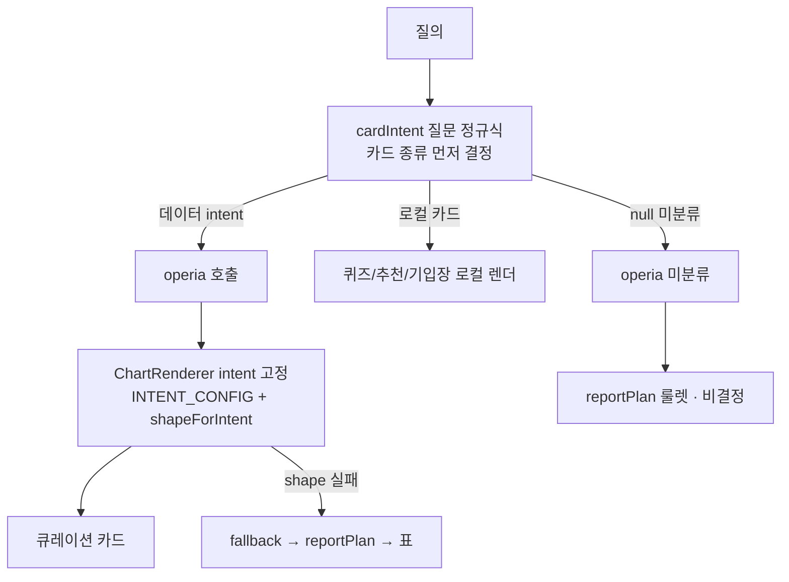
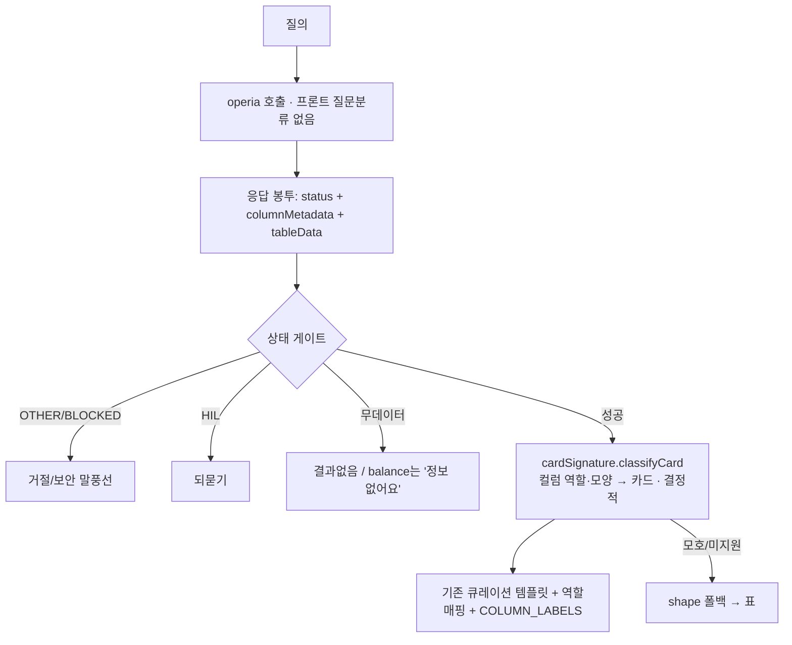

# 01. 카드 선택 축 전환 — 질문 분류 → 응답 컬럼 시그니처

- 상태: 적용됨 (브랜치 `feat/semantic-presentation`, 로컬 빌드 green + 골든 15/15)
- 날짜: 2026-07-15
- 관련: 설계서 `design_card_axis_shift_final.md`, operia 구조 `오페리아_구조_프론트엔드_설계참고.md`

## 배경 / 문제
카드 종류를 **질문 텍스트 정규식(`cardIntent`)** 으로 먼저 정하던 구조라:
- operia COORDINATOR와 **이중 분류**, 표현 변형에 취약("에듀포인트 얼마야"는 잡고 "…알려줘"는 놓침 = whack-a-mole).
- 오분류 시 operia reportPlan(LLM) 폴백으로 새서 **비결정적**(같은 질의가 매번 다른 카드).
- operia는 카드 종류를 응답에 안 실어주므로, 카드의 유일한 **결정적 신호 = 돌아온 컬럼(역할·모양)**.

## AS-IS 흐름 (변경 전)

문제 지점: **카드 종류가 "질문"에서 결정** → 표현 변형에 흔들리고, 미분류가 비결정 폴백으로 샘.

## TO-BE 흐름 (변경 후 · 현재)

핵심: **카드 종류가 "응답 컬럼 시그니처"에서 결정**(질문 텍스트 안 봄) → 표현 무관·매번 동일. 상태(OTHER/HIL/무데이터)는 1급 처리.

## 시그니처 → 카드 매핑
| 컬럼 시그니처(역할·모양) | 카드 |
|---|---|
| 잔액 3컬럼(단일행) | balance(3항목) |
| 단일행 · 숫자 1 | 단일 KPI |
| 범주 + 금액 (+%) | 사용처/가맹점별(barlist) — catSpend·merchantBreakdown 병합 |
| 시간축(YYYY-MM[-DD]) + 금액 | 월별 report(선/막대) |
| 좌표(lat/lng) | merchantMap(지도) |
| channel + 거래행 | channelSpend |
| sch_nm + 금액 + user_cnt/avg | schoolCompare |
| 그 외/모호 | shape 폴백 → 표 |

## 주요 결정 (왜)
- **D1** 카드 선택 축 = 질문 → 컬럼 시그니처. (결정적·프론트소유·operia 비결정 비의존)
- **D2** 로컬 카드(퀴즈·추천·용돈기입장) 제거 → `src/_archive/`. (컬럼 없는 예외 소거, 모든 질의 operia 직행)
- **D3** 시그니처 엔진 = `src/charts/cardSignature.js`(순수함수, 질문 텍스트 입력 안 받음). 현행 SLOTS/roleOf 역산 → 패리티 보장.
- **D4** 상태 게이트 1급화(operia `status/hilRequired` 우선, 없으면 추정 폴백).
- **D5** 유지: 템플릿 8종·roleOf·`COLUMN_LABELS`·shape 폴백.
- **D6** 모호 시그니처(범주+금액+%)는 하나로 병합(질문 힌트 재도입 금지).

## 핵심 파일
- `src/charts/cardSignature.js` — 시그니처 분류기(신규, 순수).
- `src/charts/ChartRenderer.jsx` — 응답 후 시그니처로 카드 선택 + 상태 게이트.
- `src/App.jsx` — 옛 cardIntent 데이터 분류·로컬 카드 참조 제거.
- `src/charts/codeLabels.js` — balance 라벨.
- `src/_archive/{quiz,recommend,ledger}.jsx` — 제거된 로컬 카드(이력 보존).

## 검증 상태
- 로컬 `npm run build` green(888 모듈), 골든 15/15 PASS.
- 라이브(operia, D: 클린 사본): balance ✅ · 월별 report(시계열) ✅ · merchantBreakdown ✅ · merchantMap ✅.
- **whack-a-mole 라이브 입증** ✅: "포인트 얼마나 모았어?"(평소 안 쓰는 표현) → balance 카드에 에듀포인트 30,000P focus로 정상. 질문 분류기 없이 컬럼만으로 올바른 카드 결정 확인.
- 미완(마무리): channelSpend/kpi 라이브 눈확인(코드·골든상 통과라 형식 확인), **master 병합·배포**.

## operia에 요청한 결정적 계약 개선(진행)
- balance 컬럼 한글 라벨 일관화, `status/hilRequired` 봉투 상시 노출, `queryBreakdown` 일관 제공, RLS 비교스코프. (요청서: `오페리아_응답계약_개선요청_가능여부확인.md`)
