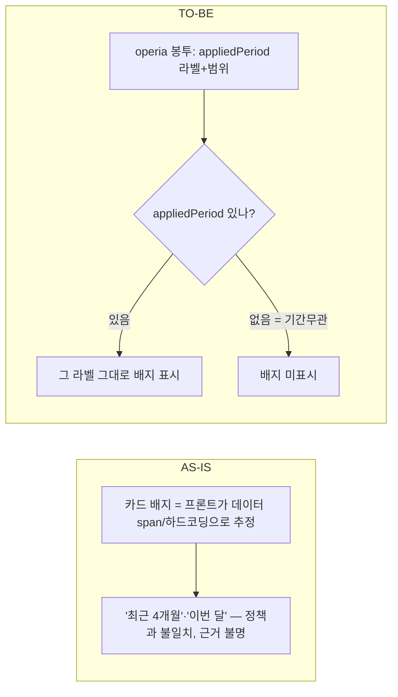

# 02. 기간 라벨 정책 — 카드 "적용기간" 배지를 operia가 준 값으로

- 상태: 설계 확정(구현 전) / 날짜: 2026-07-23
- 근거: `오페리아_코어50_기간정책_0723.xlsx`, `qa_코어50_대표검증_0716.md`, 01(카드 선택 축 전환)

## 배경 / 문제
operia에 **질의별 기본기간 정책**이 생김(2026-07-23):
- 버킷: **최근 3개월(31) / 최근 6개월(3) / 전체(7) / 기간무관(9)**.
- 원칙: 명시 기간(이번달/작년 등) 있으면 override, 없으면 기본기간. **자산·가맹점마스터는 date_filter 미적용(기간무관)**.
- 정책 요구: 기본기간 적용 시 **카드에 "적용기간 라벨" 표시**(조용한 불일치 방지). 특히 총액(id27).

문제: 01에서 **프론트 질의 분류(cardIntent)를 제거**했으므로, 프론트는 "이 질의의 적용기간이 최근 6개월"임을 **스스로 알 수 없다**. 실제로 현재 배지가 정책과 어긋남:
- "달마다 얼마 썼어" → 화면 **"최근 4개월"** vs 정책 **최근 6개월**.
- "제일 많이 쓴 달이 언제야" → **"이번 달"**(peak인데 이번 달로 좁힘).

## 결정 사항
- **D1. 라벨 소스 = operia가 준 값** — operia가 date_filter 적용 주체이므로, 응답 봉투의 **`appliedPeriod`**(라벨+범위)를 **단일 진실**로 삼아 프론트는 그대로 표시. (프론트 span 추측·정책표 하드코딩 금지 — 후자는 cardIntent 부활)
- **D2. 배지 표시 조건 = `appliedPeriod` 있을 때만** — 없으면 배지 미표시. → **기간무관(자산·가맹점마스터) 자동 무배지**, **명시 기간 override 자동 반영**(operia가 override한 기간을 그대로 실어줌).
- **D3. window vs 실데이터** — 라벨은 operia가 준 **적용 window 그대로**("최근 6개월"), **차트는 있는 데이터만**(빈 달 조작 금지). 정책의 "적용 기준 숨기지 말라" 취지.
- **D4. 현재 하드코딩/데이터-span 도출 배지 로직 제거.**

## AS-IS → TO-BE

## 영향 범위
- 프론트: 카드 배지 생성부(현 하드코딩/span). `appliedPeriod` 소비로 교체.
- operia(요청): 봉투에 `appliedPeriod` 추가 → `오페리아_기간정책_프론트요청_0723.md`.

## 열린 이슈 / 후속
- operia `appliedPeriod` 계약 확정(필드명·형식) 전까지는 배지 보수적으로(불확실하면 미표시).
- peak 질의(#7 "제일 많이 쓴 달")가 "이번 달"로 좁혀지는 건 **operia date_filter 버그**(기본 window로 잡아 그 안 peak여야) → operia 요청에 포함.
- 골든/평가: 기간은 date_filter 소관, 골든은 date-less 유지(정책 명시).
