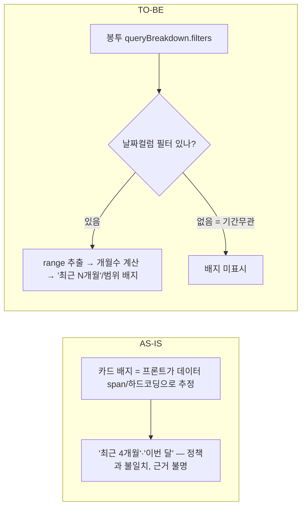

# 02. 기간 라벨 정책 — 카드 "적용기간" 배지를 operia가 준 값으로

- 상태: 설계 재정의(2026-07-23) — 라벨 소스를 operia `appliedPeriod` → **응답 봉투에 이미 있는 실제 필터 범위**로 변경 / 날짜: 2026-07-23
- 근거: `오페리아_코어50_기간정책_0723.xlsx`, `qa_코어50_대표검증_0716.md`, 01(카드 선택 축 전환), 스트림 실측(2026-07-23, Claude in Chrome)

## 배경 / 문제
operia에 **질의별 기본기간 정책**이 생김(2026-07-23):
- 버킷: **최근 3개월(31) / 최근 6개월(3) / 전체(7) / 기간무관(9)**.
- 원칙: 명시 기간(이번달/작년 등) 있으면 override, 없으면 기본기간. **자산·가맹점마스터는 date_filter 미적용(기간무관)**.
- 정책 요구: 기본기간 적용 시 **카드에 "적용기간 라벨" 표시**(조용한 불일치 방지). 특히 총액(id27).

문제: 01에서 **프론트 질의 분류(cardIntent)를 제거**했으므로, 프론트는 질의 텍스트만으로 "이 질의의 적용기간"을 알 수 없다. 실제로 현재 배지가 정책과 어긋남:
- "달마다 얼마 썼어" → 화면 **"최근 4개월"** vs 정책 **최근 6개월**.
- "제일 많이 쓴 달이 언제야" → **"이번 달"**(peak인데 이번 달로 좁힘).

## 발견 (2026-07-23, 스트림 실측)
백엔드 `appliedPeriod` 필드가 **없어도** date_filter가 적용한 실제 범위가 **응답 봉투에 이미 실려온다**. "달마다 얼마 썼어" 라이브 실측(Claude in Chrome, fetch 후킹):
- `queryBreakdown.filters[]` — **구조화**, 이게 정본 소스:
  ```json
  {"column":"dlng_ym","op":"BETWEEN","literals":["202601","202607"],"clause":"where","label":"DLNG_YM"}
  ```
- `queryInfo.조건` — 문자열 백업: `["DLNG_YM BETWEEN 202601, 202607"]`
- `clause:"where"`라 SQL 파생 = **결정적**(reportPlan 라벨과 달리 LLM 비결정 아님). 자산·가맹점마스터처럼 date_filter 미적용이면 이 필터가 **아예 없음** → 무배지 자동.

## 결정 사항
- **D1. 라벨 소스 = 응답 봉투의 실제 필터 범위** — `queryBreakdown.filters[]`에서 **날짜 컬럼**(`dlng_ym`·`dlng_dt` 등) 필터의 `op`+`literals`를 읽어 range를 얻는다. (백업: `queryInfo.조건` 문자열 파싱.) date_filter가 적용한 값 그 자체라 결정적. **`appliedPeriod` 필드에 의존하지 않는다**(없어도 됨).
- **D2. 배지 표시 조건 = 날짜 필터가 있을 때만** — filters에 날짜 컬럼 필터가 없으면 배지 미표시. → **기간무관(자산·가맹점마스터) 자동 무배지**, **명시 override는 그 범위가 그대로 filters에 실리므로 자동 반영**.
- **D3. 라벨은 A방식(범위 그대로 계산), B방식(정책 버킷 이름 역매핑) 금지.**
  - **A(채택)**: range로 라벨을 만든다 — 예 `"최근 N개월"`(end−start 개월수) 또는 `"2026.01~2026.07"`. **실제 적용값에 정직** = 배지 목적(조용한 불일치 방지)에 부합.
  - **B(금지)**: 계산한 개월수를 operia 정책표(3/6개월·전체)에 끼워맞춰 `"최근 6개월"`로 표기. **금지 이유**: ① operia 버킷 경계(포함/미포함·기준월)를 프론트가 하드코딩 → 정책 변경 시 드리프트 = 01에서 없앤 "프론트가 operia 판단 재현" 커플링 재발. ② "전체"는 range만으론 장기 명시범위와 구분 불가, 명시 override도 default 버킷과 구분 불가(source 정보 없음).
- **D4. window vs 실데이터** — 라벨은 **적용 필터 범위 그대로**, **차트는 있는 데이터만**(빈 달 조작 금지).
- **D5. 현재 하드코딩/데이터-span 도출 배지 로직 제거**, D1~D3 경로로 교체.
- **D6. `appliedPeriod`는 선택(nice-to-have)** — 정책 **버킷 문구**("최근 6개월")나 **source**(default vs explicit) 표기가 정말 필요해질 때만 operia에 요청. 배지 표시 자체는 지금 프론트만으로 가능.

## AS-IS → TO-BE


## 영향 범위
- 프론트: 카드 배지 생성부(현 하드코딩/span) → `queryBreakdown.filters` 날짜컬럼 추출→range→라벨로 교체. **백엔드 대기 불필요.**
- operia(요청): `appliedPeriod`는 **선택으로 강등**(D6). 버킷 문구·source가 필요해질 때만 → `오페리아_기간정책_프론트요청_0723.md`.

## 열린 이슈 / 후속
- 날짜 컬럼 화이트리스트 필요(`dlng_ym`=YYYYMM 월, `dlng_dt`=YYYYMMDD 일). 월/일 granularity에 따라 라벨 포맷 분기.
- `op`가 `BETWEEN` 외(`>=`/`<=` 단측, 복수 날짜필터)일 때 range 조합 규칙 정의.
- "전체"·명시 override는 range로 정확히 이름붙일 수 없음(정직한 범위 라벨로 대체) — 버킷 문구가 정말 필요하면 D6.
- peak 질의(#7 "제일 많이 쓴 달") 기본기간 = **전체**로 결정(2026-07-23). operia가 전체 기간에서 peak 반환하도록 조정(→ `오페리아_기간정책_프론트요청_0723.md` §2). 전체면 배지는 실제 데이터 span 범위로 표시("전체" 이름은 안 붙임, D3-A 원칙).
- 골든/평가: 기간은 date_filter 소관, 골든은 date-less 유지(정책 명시).
