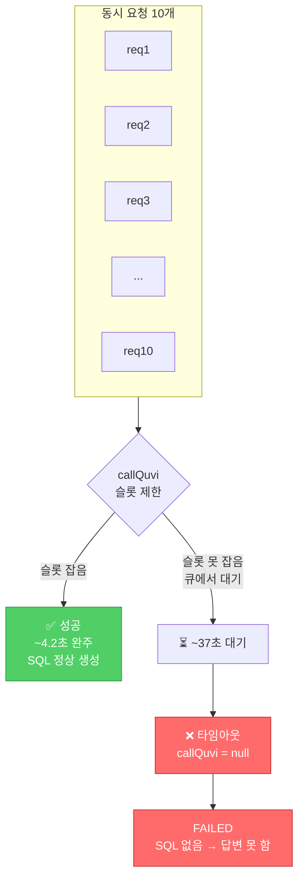
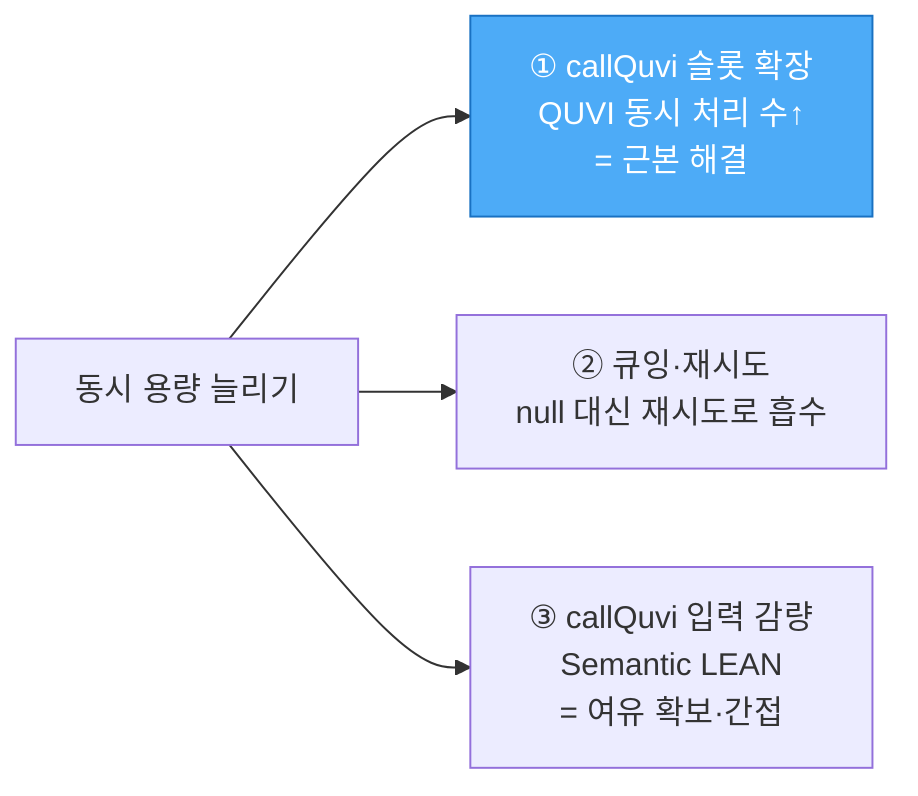
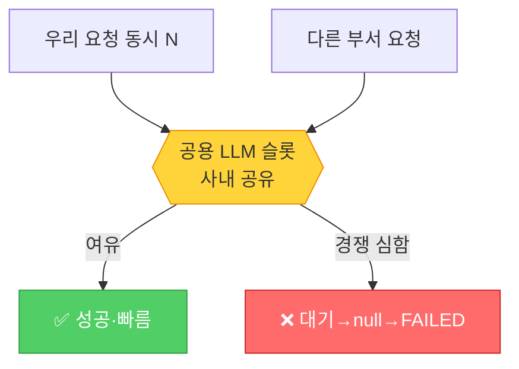

# 그림으로 보는 — operia 동시접속 병목 (callQuvi)

> 한 줄: **파이프라인은 여러 단계지만, 동시성 천장은 callQuvi(SQL 생성) 한 곳에서 결정된다.**

---

## 1. 요청 하나가 지나는 길 (10단계)


- 앞 단계들(COORDINATOR·PLANNER·classify·date_filter)은 각자 LLM 호출이지만 **완주는 함**.
- **callQuvi = SQL을 실제로 만드는 단계**. 여기가 제일 무겁고(정상일 때 8.9초·입력 5,906토큰), 동시성이 오르면 **여기서 막힌다.**

---

## 2. 왜 막히나 — "슬롯"이 부족하다

callQuvi(QUVI 서비스)가 **동시에 처리할 수 있는 자리(슬롯)가 제한**돼 있음. 동시 요청 10개가 몰리면:



- **슬롯 잡은 요청** → callQuvi가 바로 SQL 생성 → 4.2초에 완주(성공).
- **슬롯 못 잡은 요청** → 큐에서 ~37초 대기 → 고정 타임아웃 → `null` 반환 → **FAILED**.
- 동시 10 지속에서 이 비율이 대략 **성공 44% : 실패 56%**.

---

## 3. 성공 vs 실패 — 시간축 비교

```
성공 요청 (슬롯 확보):
 |■ COORDINATOR·PLANNER·classify·date_filter (앞단계)
 |■■■■ callQuvi 정상 응답
 |■ 답변
 └─────────────▶ 약 4.2초  ✅

실패 요청 (슬롯 못 잡음):
 |■ 앞단계
 |■■■■■■■■■■■■■■■■■■■■■■■■■■■■■■■■  callQuvi 큐 대기…
 |                                  → 37초 후 null
 └───────────────────────────────▶ 약 39.6초  ❌ FAILED
```

**같은 질문("이번 달 결제 몇 건이야")인데** 슬롯을 잡았느냐 아니냐로 운명이 갈림. 토큰 양·질문 난이도 때문이 아님.

---

## 4. 핵심 오해 정리

| 오해 | 사실 |
|---|---|
| "토큰이 많아서 느리고 실패한다" | ❌ 실패한 요청은 callQuvi input이 오히려 작았음(792). **토큰은 실패 원인이 아님** |
| "DB(1000만 건)가 병목" | ❌ DB는 인덱스로 스케일함. 병목은 **callQuvi(LLM SQL 생성)** |
| "파이프라인 전체가 문제" | ❌ 사망 지점은 **callQuvi 한 곳**. 앞 단계는 완주함 |
| "느린 것뿐" | ❌ 느린 게 아니라 **null 반환 = 아예 실패**(답을 못 줌) |

---

## 5. 그래서 뭘 하면 되나



- **① 슬롯 확장이 근본**: callQuvi(QUVI)가 동시에 더 많이 처리하게. (운영팀 확인 필요)
- **② 재시도**: 타임아웃 null을 바로 실패시키지 말고 재시도로 흡수.
- **③ 입력 감량**: callQuvi 프롬프트를 줄이면 처리가 빨라져 슬롯 회전↑ → 여유 확보(간접).

---

## 6. ★ 중요 정정 — 슬롯은 "사내 공용"이다

위 "슬롯 제한" 그림은 맞지만, **그 슬롯이 우리 전용이 아니라 사내 여러 부서가 공유하는 LLM 자원**이다(동현 확인).

- 정밀 계단식(2→4→6→8→10) 재실측에선 동시 10도 **성공률 95%** — 즉 "동시 10에서 무너진다"는 재현 안 됨.
- 앞서 single-10에서 44%가 나온 건 **그 순간 다른 부서가 공용 LLM을 같이 쓰던 경쟁 상황**이었을 가능성이 큼.



**결론**: 성공률은 우리 동시성만으로 안 정해지고, 그 순간 **공용 LLM 전체 부하**에 좌우됨. 따라서 우리 파이프라인 최적화(§5) + **전용 슬롯/쿼터 확보**가 함께 필요. (§ 결과문서 8.5 참조)
